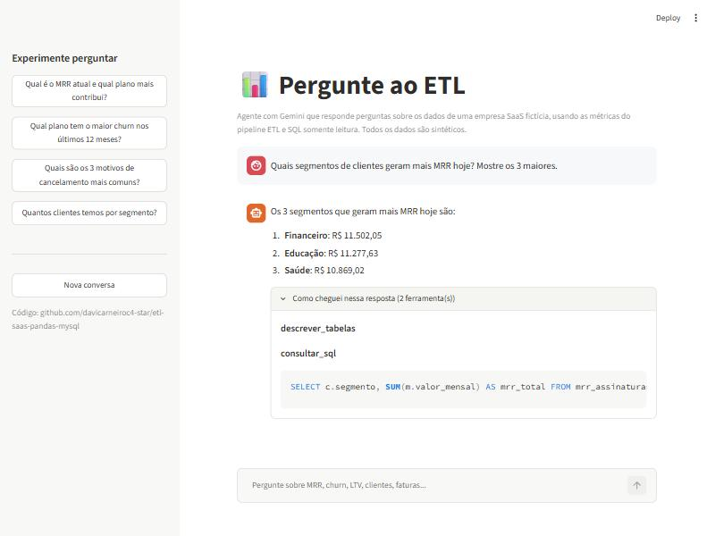

# Pergunte ao ETL | Agente de IA com Gemini, DuckDB e Streamlit

Um agente com **Google Gemini** que responde em português perguntas sobre os dados de uma empresa SaaS fictícia, como "qual plano tem o maior churn?" ou "quantas faturas estão atrasadas?". O modelo não calcula nada de cabeça: ele escolhe uma **ferramenta**, a ferramenta consulta os dados e o modelo explica o resultado, mostrando o SQL que usou.

**Demo online:** https://pergunte-ao-etl.streamlit.app/ (se estiver dormindo, clique em "Wake up" e aguarde uns 30 segundos)



## De onde vêm os dados

Os dados são **sintéticos** e saem do meu projeto [Pipeline ETL SaaS](https://github.com/davicarneiroc4-star/etl-saas-pandas-mysql): um banco MySQL propositalmente sujo, limpo com Pandas. Este repositório usa só o resultado final do pipeline, os CSVs de `dados_limpos/` (8 tabelas, cerca de 28 mil registros), e as mesmas regras de MRR, churn e LTV ([`metricas_saas.py`](metricas_saas.py)). Por isso o assistente roda sem banco de dados.

## Como funciona

```
pergunta ──► Gemini (function calling) ──► escolhe a ferramenta
                                              │
        ┌──────────────┬──────────────┬───────┴──────┬────────────────┐
  calcular_mrr   churn_mensal   ltv_por_plano   descrever_tabelas   consultar_sql
        └──────── regras do projeto ETL ────────┘                  (DuckDB, só leitura)
                         (metricas_saas.py)
                                              │
                         resposta + ferramentas e SQL usados
```

- **Ferramentas** ([`ferramentas.py`](ferramentas.py)): MRR, churn e LTV usam as funções de cálculo do projeto ETL. Para o resto, o agente escreve SQL em cima dos CSVs, carregados num DuckDB em memória.
- **Transparência:** cada resposta mostra quais ferramentas foram chamadas e o SQL executado.
- **Segurança do SQL:** só uma consulta por vez, só `SELECT`/`WITH`, no máximo 100 linhas, e o DuckDB fica sem acesso a arquivos e rede depois de carregar os dados. Testado: `DELETE`, `DROP` e `read_csv('.env')` são bloqueados.
- **Contra números inventados:** se o modelo responder com números sem ter chamado nenhuma ferramenta, o agente pede para ele refazer a resposta consultando os dados. Se mesmo assim não consultar, a resposta sai com um aviso. As ferramentas devolvem percentuais já arredondados, para o modelo só copiar.
- **Camada gratuita:** o agente tenta os modelos em ordem (`gemini-3.5-flash-lite`, depois outros) e troca sozinho quando um está sobrecarregado ou sem cota, sem perder a conversa. A resposta leva de 5 a 40 segundos.

## Como rodar

1. Crie uma chave gratuita em [aistudio.google.com](https://aistudio.google.com) e coloque no `.env` (veja o [`.env.example`](.env.example)): `GEMINI_API_KEY=sua_chave`.
2. Instale e rode:

```bash
pip install -r requirements.txt
python agente.py                 # chat no terminal
python -m streamlit run app.py   # tela no navegador
python -m pytest tests           # testes da trava de segurança do SQL (pip install pytest)
```

> As respostas são geradas por um modelo de IA e podem conter erros. Os números vêm sempre das ferramentas, e o SQL usado aparece na tela para conferência.

## Estrutura

```
├── app.py              (tela em Streamlit)
├── agente.py           (Gemini + function calling, chat no terminal)
├── ferramentas.py      (métricas e SQL somente leitura)
├── metricas_saas.py    (regras de MRR, churn e LTV do projeto ETL)
├── dados_limpos/       (CSVs gerados pelo pipeline ETL)
├── tests/
│   └── test_ferramentas.py
├── imagens/
├── requirements.txt
└── .env.example
```

## Tecnologias

Python · Google Gemini (google-genai, function calling) · DuckDB · Pandas · Streamlit · pytest
